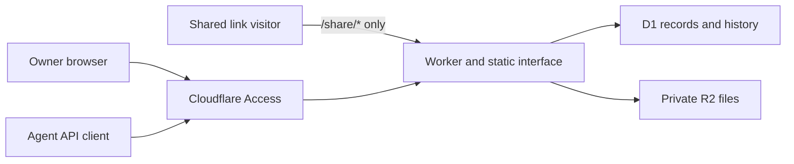

# Home Inventory

A private home inventory that you deploy to your own Cloudflare account.
Store photos, purchase details, receipts, places, and notes. Use the API to let agents maintain your collection.

The source code is public. Each deployment requires login and uses its owner's database and file storage.
This repository contains sample records and illustrations, with no personal inventory or deployment credentials.


## Try it locally

Use Node 24.10 or later and npm. Local development needs no Cloudflare account or secrets.
Copy the clone URL from GitHub's **Code** menu and replace `YOUR_REPOSITORY_URL` below.

```sh
git clone YOUR_REPOSITORY_URL home-inventory
cd home-inventory
npm ci
npm run db:local
npm run dev -- --port 8787
```

Open `http://127.0.0.1:8787`. Open `http://127.0.0.1:8787/?sample=1` to explore the sample collection.
Sample records stay in browser memory. Local records use a separate D1 database and R2 storage simulation.
Keep the development server on localhost.

## Features

- Photo cards, list view, search, tags, and nested places.
- Purchase dates, prices, currencies, sellers, warranties, receipts, and product links.
- Recipient marks for purchases you bought for someone else.
- Repeat purchases grouped by product, with separate records, quantities, prices, and history.
- Inbox cards with Keep, Later, Edit, Archive, Delete, and Undo buttons. Swipes and keyboard controls also work.
- Sorting by name, update date, purchase date, and price. A filter shows items without photos.
- Price sorting compares USD estimates across currencies and shows the original amounts with the reference-rate date.
- Public item pages with selected fields, cleaned photos, expiry, preview, and link revocation.
- Comments that remain separate from agent edits, revision checks, and change history.
- Recoverable photo removal, item archiving, and confirmed permanent deletion.
- ZIP exports with records and files. The agent CLI streams larger exports.
- Google or email-code login through Cloudflare Access, plus service tokens for agents.

Later skips an inbox card for the current browser session. Keep and Archive change the selected purchases.
Delete opens a confirmation for the displayed purchase. Other purchases in the group remain. Deletion cannot be undone.
The item editor shows the current photo beside the option to add another photo.
Undo rejects newer edits. Each decision processes up to 200 purchases.

## Deploy your own

Follow [the Cloudflare setup guide](docs/DEPLOY.md).
It covers storage, Access, optional Google login, agent access, migrations, and deployment with `cf`.
Use GitHub's **Use this template** button to create a separate private repository for your deployment.

Copy `deployment.example.json` to `deployment.local.json` and enter your resource identifiers.
Git ignores your local deployment file. Production builds stop when required settings are missing or invalid.
Keep credentials in your secret manager. The deployment file contains identifiers, not secrets.



The Worker checks signed Access tokens before serving private pages, API responses, or original files.
Production disables local authentication, `workers.dev`, and preview URLs.
An owner deploys one shared collection. The application has no separate roles or collections for different users.
Every permitted user and agent can read, edit, delete, and share collection data.
Public share pages expose only selected snapshots. Enable the narrow Access exception described in [the deployment guide](docs/DEPLOY.md#optional-public-item-sharing).

## Agents and API

Set `INVENTORY_URL` to your HTTPS origin, such as `https://inventory.example.com`.
Inject `CF_ACCESS_CLIENT_ID` and `CF_ACCESS_CLIENT_SECRET` through your secret manager.

```sh
node scripts/inventory.mjs list
node scripts/inventory.mjs get ITEM_UUID
node scripts/inventory.mjs create < item.json
node scripts/inventory.mjs export /absolute/path/to/new-backup
```

Read [the API guide](docs/API.md) before editing records.
Read the current revision, preserve unrelated fields, and add evidence links for purchase details.
Leave unknown prices and places empty. Use stable UUIDs when retrying creation.

The project has no built-in email scanning or store login integration.
An external agent can collect purchase details and submit them through the API.

## Cost

No scheduled jobs, containers, or continuously running server are required.
Idle deployments consume storage. Account subscriptions, domain registration, and storage above included allowances can still incur charges.
Traffic adds Worker, D1, and R2 operations. Free allowances depend on your account and plan.
Browser uploads resize photos to 1,600 pixels and encode WebP, with JPEG fallback for browsers without WebP encoding.

Check current pricing for [Workers](https://developers.cloudflare.com/workers/platform/pricing/),
[D1](https://developers.cloudflare.com/d1/platform/pricing/),
[R2](https://developers.cloudflare.com/r2/pricing/), and
[Access](https://www.cloudflare.com/plans/zero-trust-services/).

## Development

```sh
npm run check
npm test
npm run build:local
```

Tests use a temporary database and file store. They do not use production credentials or inventory.
Production builds use `npm run build` after you configure your deployment.
The CLI packages are pinned in `package-lock.json`. The `cf` CLI currently uses a beta release.

Price sorting uses a stored reference-rate snapshot from Frankfurter, based on ECB rates.
It makes no exchange-rate requests while people browse. The interface shows the reference date.
Run `npm run rates:update` to refresh the snapshot, then review, test, and deploy the change.
Reference estimates do not change recorded purchase amounts or currencies.

Use [the contribution guide](CONTRIBUTING.md) for changes and [the security guide](SECURITY.md) for access boundaries.
The original layout samples remain in `design-preview/` and contain synthetic records.
The MIT [license](LICENSE) permits use, modification, and deployment.

Exports use the `home-inventory-v1` format identifier. See [the export format](docs/API.md#exports).


## Collection sharing and browsing

Use the Share icon on any collection photo, list row, or item detail header.
Open the collection actions menu (•••), choose Select items, then Share to publish one collection page.
Filters groups the missing-photo and recipient controls. Active filters remain visible when the panel closes.
On phones, selection actions stay at the bottom. Sharing has separate Details and Preview views.

Each collection supports up to 20 selected purchases. Choose a title, public description, fields, photos, and expiry.
Use Shared collections in the collection actions menu to find, copy, or revoke saved links. Apply migration `0005_collection_shares.sql` before deployment.
Public collection pages use the existing `/share/*` Access rule. See `docs/API.md` for agent endpoints.

The collection loads its next page before you reach the bottom. Load more remains available after a request fails.
Public pages include social image metadata. Messaging services can retain cached previews.


For browser regression checks, start the local server on port 8797. Then run `python3 scripts/verify-browser.py`.
This optional check requires Python, Playwright, and its WebKit browser. It uses synthetic local records and removes them afterward.
It checks iPhone sharing, selection, public photos, paging order, scroll position, failed requests, retries, and ZIP exports.
Run `python3 scripts/verify-inbox-browser.py` to check Delete on desktop and mobile, including cancellation, errors, and grouped purchases.
Set `TEST_URL` to use another localhost port. The script rejects remote hosts.
